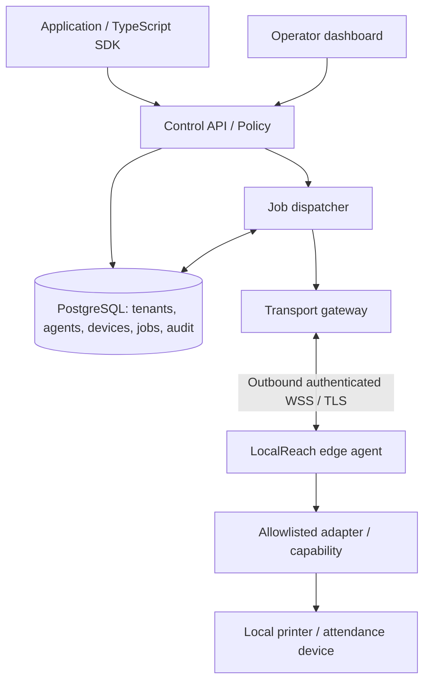

# RFC-0001: Capability-first edge connectivity

**Status:** Proposed; needs review and experiments. **Date:** 2026-10-13.

## Context and decision
Build a *modular control-plane application* with an independent edge agent and transport gateway. Avoid a microservice mesh or new tunnel protocol at the start. Applications submit typed, authorized operations rather than raw LAN addresses.



This is a logical topology, not a guarantee of exactly one server instance.

## Proposed component boundaries
- **Control API (TypeScript, Fastify candidate):** authenticated tenant administration, pairing invitations, device approval, capability permissions, command submission and status queries. No direct device sockets.
- **PostgreSQL:** durable tenant, agent, device, grant, command, attempts and audit records. Never store high-frequency socket presence as a database source of truth.
- **Dispatcher:** bounded leasing and requeue for deliveries. Does not mistake delivery acknowledgement for device execution success.
- **Transport gateway (Go candidate):** authenticates agent connections, manages online routing, heartbeat, flow control and reconnection. Horizontally partitionable; no permanent business data.
- **Edge agent (Go candidate):** local credentials, bounded discovery, adapters, local queue/journal, connection supervision, safe cancellation, per-operation policy enforcement.
- **SDK + console:** hide connectivity complexity; provide informative statuses and safe recovery.

## Protocol proposal
Agent opens outbound TLS-secured WebSocket, with mutually authenticated or equivalently cryptographically bound agent identities. A control message includes protocol version, opaque command ID, tenant/agent/device IDs, operation, schema version, expiry and monotonic per-session delivery identifier. Avoid relying on connection state for authorization. Enforce operation scope on cloud AND edge.

Command states:
```
ACCEPTED -> QUEUED -> DISPATCHED -> RECEIVED -> EXECUTING -> SUCCEEDED
                                                     |-> FAILED
                                                     |-> INDETERMINATE
                    |-> EXPIRED
                    |-> CANCELLED (only before irreversible execution)
```
Actual transitions and actor ownership require a follow-up detailed spec. Duplicate delivery may occur; use idempotency keys and an agent-side journal with bounded retention. Printer write success is not proof paper was printed. For non-idempotent device effects, an ambiguous outcome should be **INDETERMINATE**, not blindly retried.

## Enrollment / identity
1. Authenticated admin chooses Connect this computer; server creates short-lived single-use pairing invitation scoped to tenant/site.
2. Signed installer is installed with explicit OS approval. Agent creates a non-exportable/OS-protected identity key when possible.
3. Agent redeems invitation over TLS; server verifies invitation, tenant ownership and device identity proof; binds agent to site.
4. Agent obtains scoped renewable credentials, establishes outbound transport and sends heartbeat; admin can revoke.
5. Automatic renewal must never override revocation. Enrollment tokens never appear in persistent logs. Pairing and replay defense are mandatory.
**Threat model note:** Do not give a generic browser page silent authority to install software or approve hardware.

## Discovery + adapter design
Adapters declare discovery scope, supported protocol, permissions and typed capabilities. mDNS/SSDP/SNMP can be evaluated case-by-case; scans are rate-limited, local-subnet constrained and user-triggered. Discovery results are **untrusted hints**; operator approval and actual protocol handshake are separate. Guard against SSRF, address changes, malicious device announcements and unexpected traffic. Default adapters do not probe unrelated IP ranges.

## Reliability
Use heartbeats, exponential backoff with jitter, bounded queues, deadlines, slow-consumer backpressure and reconnect resume tokens. Track accepted vs delivered vs executed distinctively. Local operations that can run without cloud should continue. During outage the server rejects/queues according to explicit TTL and per-operation rules; the UI never promises immediate success.

## Tenant isolation and authorization
Tenant membership validated at API boundary; each agent/device permanently belongs to one tenant/site unless explicitly reprovisioned. Grant operations individually; require approval for higher-impact actions. Validate command payload schemas and maximum sizes; limit requests and device access. Separate identities for users, applications and agents. Cryptographic keys require rotation, revocation and secure local storage.

## Operations / scale
Start with one region and a deployment topology that can be backed up and monitored. Explicit metrics: agent connection count, reconnect storms, relay throughput, queue depth, attempt latency, errors by adapter, data retention, disk pressure. Never assume PostgreSQL alone is a broker for millions of concurrent deliveries. Before clustering, benchmark and define connection ownership/routing semantics. Backup and restore testing is required.

## Tradeoffs and alternatives
- WebSocket relay: broad firewall compatibility, less complexity; requires cloud egress and server bandwidth.
- Existing overlay / P2P: possible later optimization but adds complexity and policy scope; evaluate rather than reinvent.
- MQTT: useful for IoT telemetry, not mandatory as first transport.
- Pure cloud solution: not viable for arbitrary unmodified LAN-only hardware.
- Generic TCP tunnel: convenient but creates dangerous lateral movement exposure; explicitly outside the default design.

## Design gates before implementation
Threat model accepted; message schema and execution journal defined; revocation test; disconnected/offline UX reviewed; license/dependency audit; benchmark protocol mock over separate networks.
